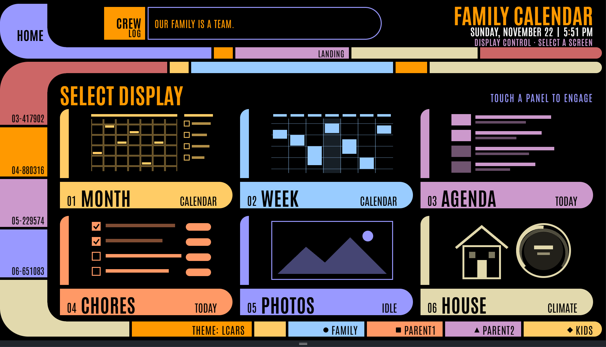
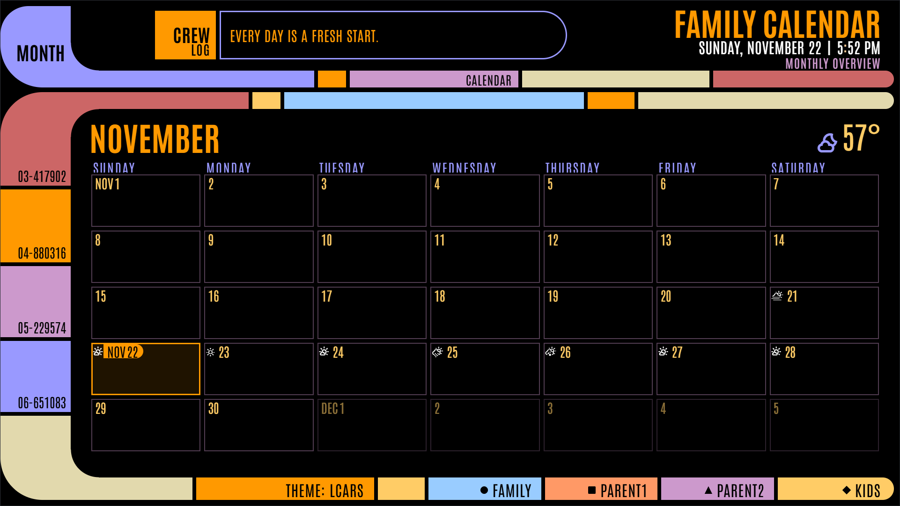
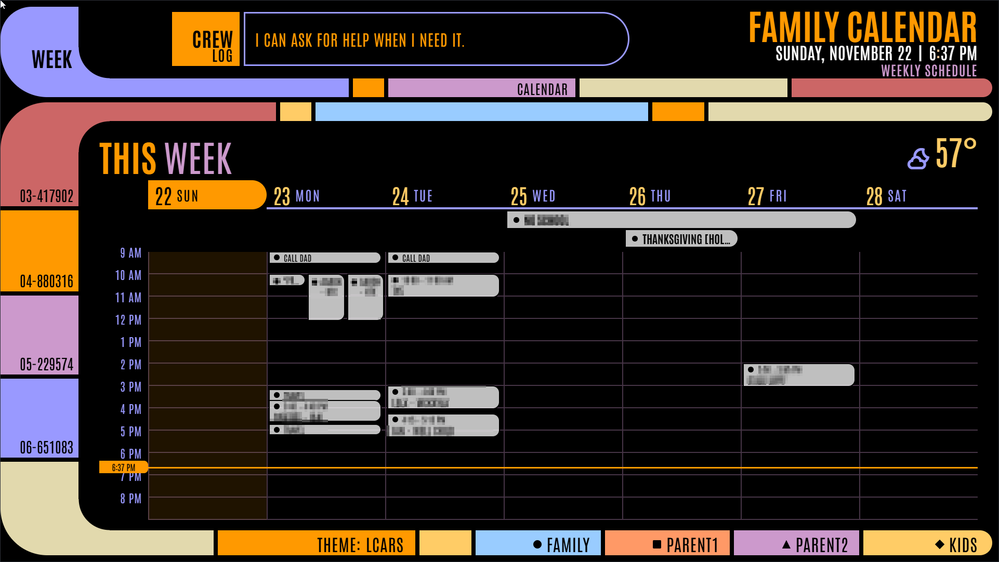
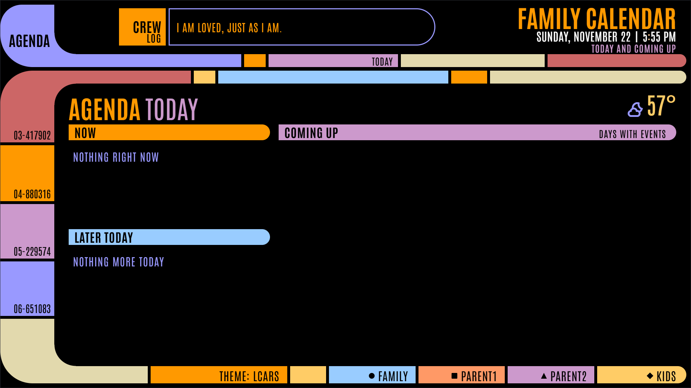
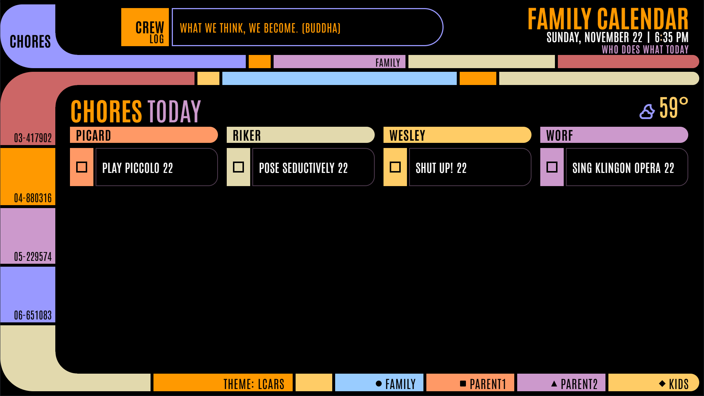
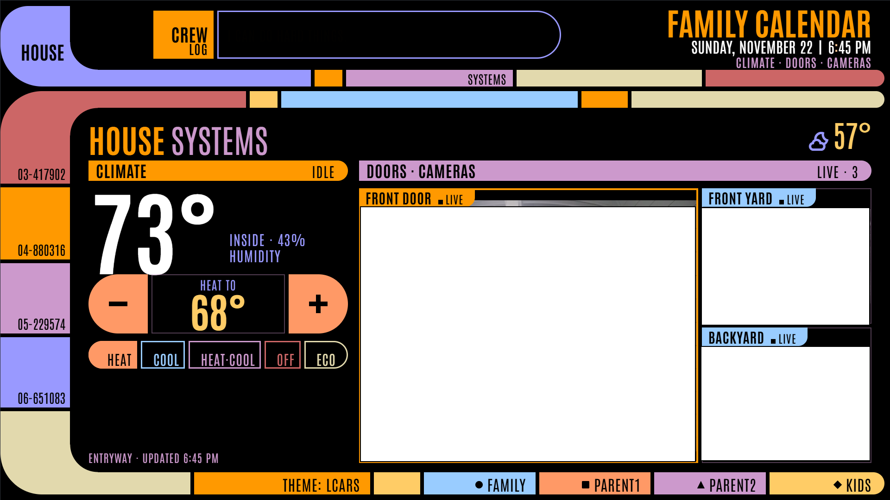
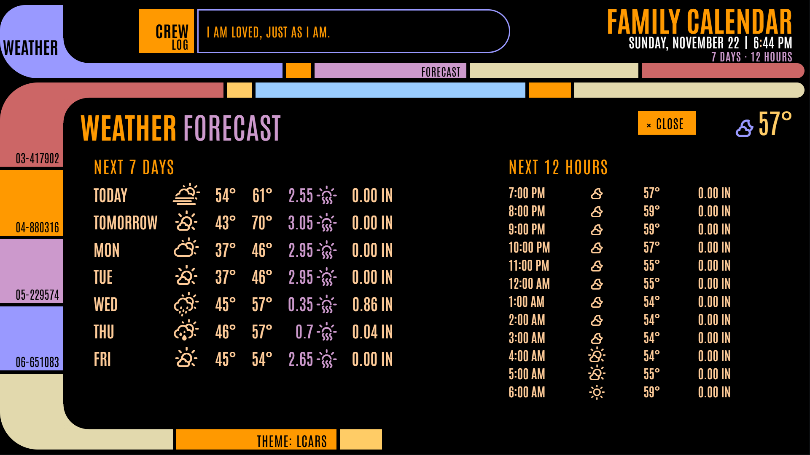
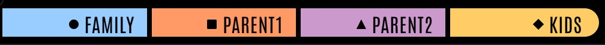

# LCARS MagicMirror

A touchscreen family calendar for [MagicMirror²](https://github.com/MagicMirrorOrg/MagicMirror), styled after the LCARS computer screens from *Star Trek: The Next Generation*. It's built for a Raspberry Pi 4 driving a 1920×1080 touchscreen, but any MagicMirror install at that resolution should work. The camera feeds are the biggest resource hog.

<!-- SCREENSHOT: hero shot of the landing screen -->


> Fan project. LCARS and Star Trek belong to their owners; this repo has no affiliation with them.

---

## What it does

- **Tap-driven pages, no rotation.** A home screen with one tile per page; tap the header elbow on any page to go back home.
- **Month, Week and Agenda views** of your calendars, each calendar with its own colour *and* shape (circle, square, triangle, diamond), so they stay readable for colour-blind viewers too.
- **Tappable calendar filter.** Pills in the bottom bar hide or show a calendar on every view, and reset themselves after 30 minutes.
- **Chores board**, one column per person, tap a chore to tick it off.
- **House page** for Google Nest: thermostat controls and live camera feeds (optional).
- **Weather chip** on every page; tap it for a 7-day and 12-hour forecast.
- **Info panel** with quotes, affirmations and time-of-day messages.
- **Photo slideshow** as a hidden page.

---

## The display

### Home
<!-- SCREENSHOT: landing screen with the six tiles -->


The landing page. Each tile opens a page: Month, Week, Agenda, Chores, Photos and House. The LCARS frame (elbows, bars, clock and the info panel) stays on every page.

### Month
<!-- SCREENSHOT: Month page with events from all four calendars -->


A full-width month grid. Events show as coloured pills with their calendar's shape marker.

### Week
<!-- SCREENSHOT: Week page with a few overlapping events -->


Sunday to Saturday, 9 AM to 9 PM, with all-day events on top and a "now" line. Up to three overlapping events sit side by side.

### Agenda
<!-- SCREENSHOT: Agenda page with Now, Later today and Coming up filled in -->


Three panels: **Now** (what's happening this minute), **Later today**, and **Coming up** (the next 7 days).

### Chores
<!-- SCREENSHOT: Chores page with two or three people, some chores ticked -->


One column per person. Chores and people are managed in MMM-Chores' own admin page.

### House (optional, Google Nest)
<!-- SCREENSHOT: House page with the thermostat and camera feeds (blur anything identifying) -->


Thermostat with temperature, mode and Eco controls, plus live camera feeds. Feeds only stream while the page is open and pause after 5 minutes without a tap.

### Weather forecast
<!-- SCREENSHOT: forecast page opened from the weather chip -->


Tap the weather chip (top right) to open it; tap Close or the chip again to go back to the page you were on.

### Calendar filter
<!-- SCREENSHOT: close-up of the bottom bar with one pill dimmed -->


Tap a pill to hide that calendar everywhere (the pill dims and its name is crossed out). Tap again to bring it back.

---

## What's in this repo

| Path | What it is |
|---|---|
| `config.js` | The MagicMirror config: every page and module. Edit the **CHANGE ME** spots. |
| `custom.css` | The whole LCARS look. |
| `fonts/` | Antonio (the LCARS-style typeface) and its license. |
| `MMM-LCARSFrame/` | The LCARS frame: elbows, bars, page names, info panel. Tap the header elbow to go home. |
| `MMM-Landing/` | The home screen tiles. |
| `MMM-CalendarFilter/` | The tappable calendar pills. |
| `MMM-WeatherNav/` | Opens and closes the forecast page from the weather chip. |
| `MMM-PhotoWake/` | Tap the photo slideshow to go back to the home screen. Optional idle screensaver (`idleMinutes`). |
| `MMM-ThemeSwitcher/` | Puts the `theme-lcars` class on the page, which every LCARS style depends on. Keep it. |
| `MMM-NestThermostat/` | Nest thermostat panel (Google Smart Device Management API). |
| `MMM-NestCameras/` | Nest camera and doorbell feeds (WebRTC, same API). |

---

## Requirements

- MagicMirror² (developed on 2.38), running in Electron (`kioskmode: true`)
- A 1920×1080 display. The layout uses fixed pixel positions, so other resolutions will need CSS changes.
- A touchscreen (a mouse works too)
- Node's built-in `fetch` (Node 18 or newer) for the Nest modules

### Third-party modules

Install these into `~/MagicMirror/modules/`:

| Module | Used for | Install |
|---|---|---|
| [MMM-CalendarExt3](https://github.com/MMRIZE/MMM-CalendarExt3) | Month view | `git clone https://github.com/MMRIZE/MMM-CalendarExt3` |
| [MMM-CalendarExt3Agenda](https://github.com/MMRIZE/MMM-CalendarExt3Agenda) | Agenda panels | `git clone https://github.com/MMRIZE/MMM-CalendarExt3Agenda` |
| [MMM-CalendarExt3Journal](https://github.com/MMRIZE/MMM-CalendarExt3Journal) | Week view | `git clone https://github.com/MMRIZE/MMM-CalendarExt3Journal` |
| [MMM-pages](https://github.com/edward-shen/MMM-pages) | Pages and hidden pages | `git clone https://github.com/edward-shen/MMM-pages` |
| [MMM-Chores](https://github.com/PierreGode/MMM-Chores) | Chores board | `git clone https://github.com/PierreGode/MMM-Chores && cd MMM-Chores && npm install` |
| [MMM-BackgroundSlideshow](https://github.com/darickc/MMM-BackgroundSlideshow) | Photo slideshow | `git clone https://github.com/darickc/MMM-BackgroundSlideshow && cd MMM-BackgroundSlideshow && npm install` |
| [MMM-Remote-Control](https://github.com/Jopyth/MMM-Remote-Control) | Sending page commands from a terminal (testing) | `git clone https://github.com/Jopyth/MMM-Remote-Control && cd MMM-Remote-Control && npm install` |

Check each module's README for its own install steps; some need `npm install`. The core `calendar`, `clock`, `weather`, `compliments` and `helloworld` modules come with MagicMirror.

---

## Install

On the Pi:

```bash
# 1. Get this repo
cd ~
git clone https://github.com/<your-account>/MMM-LCARS.git

# 2. Link the custom modules into MagicMirror
for m in MMM-LCARSFrame MMM-Landing MMM-CalendarFilter MMM-WeatherNav MMM-PhotoWake \
         MMM-ThemeSwitcher MMM-NestThermostat MMM-NestCameras; do
  ln -sT ~/MMM-LCARS/$m ~/MagicMirror/modules/$m
done

# 3. Config, CSS and font (back up your own config.js first if you have one)
cp ~/MMM-LCARS/config.js  ~/MagicMirror/config/config.js
cp ~/MMM-LCARS/custom.css ~/MagicMirror/config/custom.css
mkdir -p ~/MagicMirror/css/fonts
cp ~/MMM-LCARS/fonts/Antonio-VariableFont_wght.ttf ~/MagicMirror/css/fonts/

# 4. Check and restart
cd ~/MagicMirror && npm run config:check
pm2 restart MagicMirror     # or however you start MagicMirror
```

Config and CSS are **copied**, not linked, so your calendar links and changes stay out of this repo's folder. Then edit `~/MagicMirror/config/config.js` (next section).

---

## Configure

Search `config.js` for **`CHANGE ME`**. That covers:

### 1. Calendars

Replace the four sample feeds with your own iCal links:

- **Google Calendar:** Settings → your calendar → *Integrate calendar* → **Secret address in iCal format**
- **Outlook / Microsoft 365:** Settings → Calendar → Shared calendars → *Publish a calendar* → ICS link

> ⚠️ These secret links work like passwords: anyone with the link can read the calendar. Never commit your real `config.js` to a public repo. If one leaks, reset the secret address in your calendar settings.

The sample calendar names are `Family`, `Parent1`, `Parent2` and `Kids`. If you rename them, change the name in **three places**:

1. the `calendar` module's `calendars` list in `config.js`
2. the `MMM-CalendarFilter` `calendars` list in `config.js` (`name` and `cls`)
3. `custom.css`: search for the old name (for example `Parent1` and `parent1`) and replace every match. Names are case-sensitive.

Colours and shapes per calendar:

| Calendar | Colour variable | LCARS colour | Shape |
|---|---|---|---|
| Family | `--blue` | sky `#99ccff` | circle |
| Parent1 | `--peach` | peach `#ff9966` | square |
| Parent2 | `--green` | lilac `#cc99cc` | triangle |
| Kids | `--pink` | gold `#ffcc66` | diamond |

The variable names are historical; change the values in the `:root` block at the top of `custom.css` to recolour a calendar.

### 2. Location (weather)

Set `LAT` and `LON` at the top of `config.js`. Weather uses [Open-Meteo](https://open-meteo.com/), so there's no API key. Switch `units` to `"metric"` if you prefer °C.

### 3. Network access

`ipWhitelist` only allows the Pi itself. To open the mirror from another computer's browser, add that computer's address in both forms (`"192.168.1.50", "::ffff:192.168.1.50"`) and give it a fixed address in your router.

### 4. Info panel messages

Edit `QUOTES`, `AFFIRMATIONS` and `FAMILY_COMPLIMENTS` at the top of `config.js`. Keep each one short: the panel holds about three lines.

### 5. Chores

Open the MMM-Chores admin page at `http://<pi-address>:5003` to add people and chores. **Settings saved in its cogwheel override `config.js`**, so set these there too: group per user **on**, show past **on**, days to show **1**, date format **empty**, level on mirror **off**, AI **off**. Start repeating chores on today's date.

The admin page has no login, so keep it on your home network.

### 6. Photos

Point `imagePaths` in the `MMM-BackgroundSlideshow` block at your photo folder (relative to `~/MagicMirror`, or an absolute path). To test it:

```bash
curl http://localhost:8080/api/notification/SHOW_HIDDEN_PAGE/photos
curl http://localhost:8080/api/notification/HOME_PAGE      # back
```

### 7. House page (Google Nest), optional

**No Nest devices?** Remove the House page:

1. delete the `MMM-NestThermostat`, `MMM-NestCameras` and `House systems` title blocks from `config.js`
2. delete the House tile in `MMM-Landing`'s `tiles`
3. delete the House entry in `MMM-LCARSFrame`'s `pages`
4. delete `["page-home"]` from `MMM-pages`'s `modules`

**With Nest devices,** you need Google's Device Access program (a one-time US$5 fee at the time of writing) and a Google Cloud project:

1. Create a Google Cloud project, enable the **Smart Device Management API**, and create an OAuth client (type *Web application*, redirect URI `https://www.google.com`).
2. Set the OAuth consent screen to **In production**. In *Testing*, refresh tokens expire after 7 days.
3. Create a project in the [Device Access Console](https://console.nest.google.com/device-access) using that OAuth client ID.
4. Link your account and get a refresh token, following Google's [Device Access quick start](https://developers.google.com/nest/device-access/get-started).
5. Put the credentials in `~/MagicMirror/config/nest.secrets.json` **on the Pi** (never in git), then `chmod 600` it:

```json
{
  "clientId": "YOUR_CLIENT_ID.apps.googleusercontent.com",
  "clientSecret": "YOUR_CLIENT_SECRET",
  "refreshToken": "YOUR_REFRESH_TOKEN",
  "projectId": "YOUR_DEVICE_ACCESS_PROJECT_ID",
  "thermostat": "enterprises/YOUR_PROJECT_ID/devices/YOUR_DEVICE_ID"
}
```

`thermostat` is optional; without it the first thermostat is used. Set the camera order in `MMM-NestCameras`'s `order` to your Nest device names; the first one is the large feed.

**Doorbell alerts** (optional): to jump to the House page when the doorbell rings, set up Pub/Sub events for your Device Access project, request the `pubsub` scope along with `sdm.service` when you get the refresh token, and add `"subscription": "projects/YOUR_CLOUD_PROJECT/subscriptions/YOUR_SUBSCRIPTION"` to the credentials file. Without `subscription`, the doorbell code stays off.

---

## Using it

| To... | Do this |
|---|---|
| Open a page | Tap its tile on the home screen |
| Go home | Tap the header elbow (top left, shows the page name) |
| Hide or show a calendar | Tap its pill in the bottom bar |
| See the forecast | Tap the weather chip; Close to go back |
| Tick off a chore | Tap anywhere on the chore's row |
| Swap the large camera feed | Tap a small feed |

---

## Customising

- **Colours:** the LCARS palette (`--lc-orange`, `--lc-gold`, ...) is in `:root` at the top of `custom.css`.
- **Page names and labels** in the frame: `MMM-LCARSFrame`'s `pages` in `config.js` (one entry per page, in page order).
- **Adding a page:** add a `["page-yourname"]` entry to `MMM-pages`, give your modules `classes: "page-yourname"`, then add a tile to `MMM-Landing` and an entry to `MMM-LCARSFrame`'s `pages`. Page numbers must line up across all three.
- **Writing your own module:** never use `hidden`, `data`, `config`, `name` or `identifier` as your own properties, and don't name methods `init`, `show`, `hide` or `stop`. They clash with MagicMirror's own and fail in confusing ways.

---

## Troubleshooting

- **A custom module doesn't appear.** Check the log (`pm2 logs MagicMirror`) for `No ... found for module`: the folder must be at `~/MagicMirror/modules/<name>/<name>.js`.
- **Calendars are empty.** Test a feed from the Pi: `curl -s -o /dev/null -w "%{http_code}\n" "<ics url>"` should print `200`. Feeds refresh every 5 minutes.
- **Everything is unstyled or the font is wrong.** Hard-reload the browser (Ctrl+Shift+R). Check `custom.css` is at `~/MagicMirror/config/custom.css` and the font at `~/MagicMirror/css/fonts/`.
- **Legend pills look wrong after renaming calendars.** The filter remembers hidden calendars in the browser. Run `localStorage.clear()` in DevTools and reload.
- **Taps on a button do nothing.** Something fixed-position is probably on top of it. In DevTools, run `document.elementFromPoint(x, y)` at the button's position.
- **Week view shows only one calendar right after a restart.** A known MMM-CalendarExt3Journal startup issue: it fixes itself on the next 5-minute refresh.
- **A ticked repeating chore shows a duplicate.** Keep MMM-Chores' "days to show" at 1 (see Configure → Chores).

---

## Credits

- [MagicMirror²](https://github.com/MagicMirrorOrg/MagicMirror) and its community
- [MMRIZE](https://github.com/MMRIZE) for the CalendarExt3 family
- [Edward Shen](https://github.com/edward-shen/MMM-pages) for MMM-pages
- [PierreGode](https://github.com/PierreGode/MMM-Chores) for MMM-Chores
- [darickc](https://github.com/darickc/MMM-BackgroundSlideshow) for MMM-BackgroundSlideshow
- [Jopyth](https://github.com/Jopyth/MMM-Remote-Control) for MMM-Remote-Control
- [Open-Meteo](https://open-meteo.com/) for weather data
- **Antonio** font: Copyright 2013 The Antonio Project Authors, licensed under the SIL Open Font License 1.1 (`fonts/Antonio-OFL.txt`)

## License

[MIT](LICENSE) The Antonio font keeps its own license (SIL Open Font License 1.1, `fonts/Antonio-OFL.txt`), and each third-party module keeps its own license in its repo.
